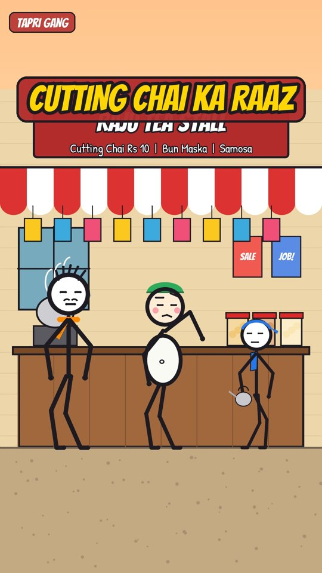
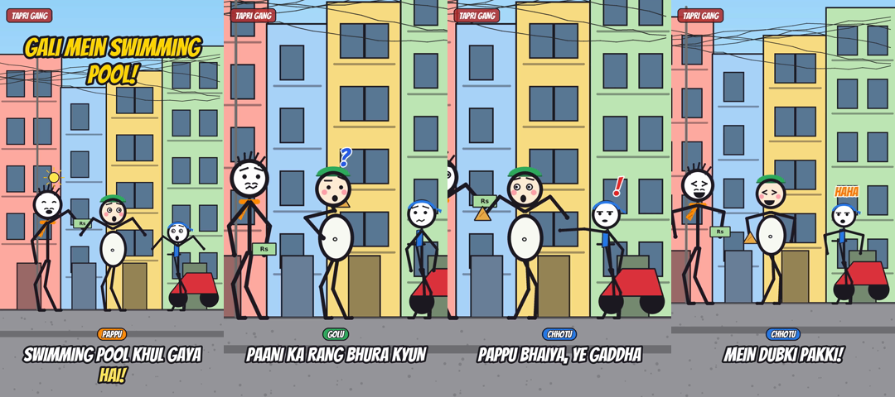

# Tapri Gang Factory

**A faceless cartoon channel that runs itself.** Idea in, finished YouTube Short out: script, voices, animation, SEO, upload,
Instagram Reel, comment replies, a daily community post and analytics, all from one PC, three times a day.

Built for **[Tapri Gang](docs/CHANNEL.md)**, a Hindi desi stickman comedy with three friends at a chai tapri, and made to be
re-skinned for your own characters, language and niche.


| First frame = thumbnail = Reel cover | A few scenes from one episode |
|---|---|
|  |  |

## What it does

```
idea  ──►  script  ──►  review  ──►  voices  ──►  animation  ──►  SEO  ──►  YouTube  ──►  Instagram  ──►  learning
(list,     (Claude or   (bad words,  (ElevenLabs, (Pillow +      (hook +    (scheduled, (Reel via     (YouTube
 inbox,     Ollama,      politics,    one voice    FFmpeg,        keyword    captions,   Meta API)     Analytics
 Telegram,  Hindi +      length,      per char,    lip sync,      title,     playlist,                feeds the
 n8n)       Hinglish)    punchline)   cached)      cuts, loop)    tags)      comment)                 next ideas)
```

- **Original animation, no stock footage:** IK-rigged stickman characters with faces, poses, props and lip sync, five hand-drawn
  locations, camera cuts, captions, sound effects made from sine waves (nothing to license), and a loop ending.
- **Writes its own episodes:** Claude (best) or a local Ollama model writes 20–35 s scenes in the characters' voices, then plain rules
  reject bad words, sensitive topics, long lines and weak endings. It invents new, seasonal ideas when the idea list runs out.
- **Voices per character:** ElevenLabs, with free Microsoft Edge voices as an automatic fallback. Every take is cached.
- **Researched SEO:** a hook-plus-keyword title chosen with vidIQ scores, a keyword-first description, tags in two scripts, and uploaded
  captions with exact timings ([research](docs/SEO_RESEARCH.md)).
- **Runs unattended:** a Windows task fills three daily slots ahead of time and uploads them scheduled, so YouTube publishes even when
  the PC is off. It retries after YouTube's upload limit and never stops on one failure.
- **Grows the channel:** first comments, in-character replies to viewers (spam and politics skipped), a daily community post kit
  (poll, quiz, image post), Instagram Reels, Telegram alerts and commands from your phone, and a daily analytics loop that learns which
  keywords, locations and hooks work.

## Quick start (10 minutes, no keys needed)

Needs **Python 3.11+** and **FFmpeg** (`winget install Gyan.FFmpeg`, `brew install ffmpeg` or `sudo apt install ffmpeg`).

```bash
git clone https://github.com/7absec/tapri-gang-factory.git
cd tapri-gang-factory
pip install -r requirements.txt
python main.py make --sample
```

That renders the built-in episode to `output/<job>/final.mp4` with the free voices. No accounts needed. Then copy `.env.example` to `.env`
and add what you have; every key is optional and the factory degrades gracefully:

| Service | What it adds | `.env` |
|---|---|---|
| **Claude** (Anthropic API) | The funniest scripts (recommended) | `ANTHROPIC_API_KEY` |
| **Ollama** (free, local) | Scripts with no API key (`ollama pull qwen2.5:14b`) | `OLLAMA_MODEL` |
| **ElevenLabs** | Real character voices | `ELEVEN_API_KEY` (+ voice ids in `data/cast.json`) |
| **vidIQ** | Title scoring and searched tags | `VIDIQ_API_KEY` |
| **YouTube Data API** | Uploading, captions, comments | `client_secret.json` + `python main.py auth` |
| **YouTube Analytics API** | The learning loop | enable it in the same Google Cloud project |
| **Telegram** | Alerts and commands on your phone | `TELEGRAM_BOT_TOKEN`, `TELEGRAM_CHAT_ID` |
| **Instagram (Meta Graph API)** | Automatic Reels | `IG_MODE=api` + `python main.py ig meta-setup` |
| **n8n** | Optional cloud orchestration | `python main.py api` |

Check everything at any time:
```bash
python main.py doctor
```

## Full setup

### 1. Script writer
- **Claude:** get a key at console.anthropic.com and set `ANTHROPIC_API_KEY`. With `LLM_PROVIDER=auto` Claude is used whenever a key is set.
- **Ollama:** install from ollama.com, run `ollama pull qwen2.5:14b`. Used when there is no Claude key. Its Hindi humour is weaker.

### 2. Voices (ElevenLabs)
Set `ELEVEN_API_KEY`. Each character's `eleven_voice` in `data/cast.json` is a voice id from the ElevenLabs Voice Library
(filter: Hindi, use case "characters & animation"). A starter plan covers 3 Shorts a day (about 15–20K characters a month).
Without a key the Edge voices are used, with a different pitch and speed per character.

### 3. YouTube
1. console.cloud.google.com → new project → enable **YouTube Data API v3** and **YouTube Analytics API**.
2. Google Auth Platform → **External**, add yourself as a test user → **Clients → Create client → Desktop app** → download the JSON as
   `client_secret.json` in the project folder.
3. Run this and sign in **with the channel's account** (pick the brand channel if asked):
   ```bash
   python main.py auth
   ```
4. **Publish the app** (Audience → Publish app). In Testing mode the sign-in expires after 7 days and uploads stop.
5. Verify the channel's phone number at youtube.com/verify: higher upload limits and custom thumbnails.

> New channels have a daily upload limit (our new channel hit it at 10 uploads on day one). The autopilot retries automatically.
> Videos from unaudited API projects can be locked private; if Studio shows that notice, apply with the
> [YouTube API audit form](https://support.google.com/youtube/contact/yt_api_form).

### 4. Automation
`.env`: `SLOTS=07:00-07:30,12:00-12:30,19:00-19:30` (exact times or windows), `TZ_NAME=Asia/Kolkata`,
`REVIEW_MODE=auto` (uploads scheduled) or `hold` (waits for `python main.py approve <job>`; use this for your first week).

**Windows:**
```bash
powershell -ExecutionPolicy Bypass -File install_autostart.ps1
```
This registers **TapriGangAutopilot** (one round every 30 minutes and at sign-in) and **TapriGangBot** (the Telegram bot).
Keep the PC plugged in with sleep off; locking the screen (Win+L) is fine.

**macOS / Linux:** `crontab -e`, then add:
```
*/30 * * * * cd /path/to/tapri-gang-factory && /usr/bin/python3 main.py once >> logs/cron.log 2>&1
@reboot cd /path/to/tapri-gang-factory && /usr/bin/python3 main.py bot >> logs/bot.log 2>&1
```

Each round: posts first comments on videos that went live, retries waiting uploads, makes the community post, replies to comments,
posts Reels, updates analytics once a day, then makes and schedules a video for every empty slot today and tomorrow.

### 5. Telegram (alerts and commands)
In Telegram open **@BotFather** → `/newbot` → copy the token into `.env` as `TELEGRAM_BOT_TOKEN`. Open your bot, press **Start**, then:
```bash
python main.py telegram setup
```
You get every scheduled upload, every failure, the 9 PM community post (text and images), a 6:30 AM summary and Reel links.
Commands: `/status` `/post` `/make <idea>` `/pause` `/resume` `/stats` `/help`. The bot only answers your own chat.

### 6. Instagram Reels
`IG_MODE=phone` sends each Reel and caption to Telegram for a 20-second manual share. `IG_MODE=api` posts automatically through the
Meta Graph API: Instagram professional account → linked to a Facebook Page → Meta app → token → `python main.py ig meta-setup`, which saves a
Page token that does not expire. Step by step: [docs/INSTAGRAM.md](docs/INSTAGRAM.md).

### 7. Community posts and replies
YouTube has no API for community posts, so at 8 PM the factory writes `community/<date>/` (text, options, images) and alerts you at 9 PM
(desktop and Telegram). The format rotates through text poll, quiz, image poll, image post and video promo.

Replies: each round new comments are sorted by the model. Praise, questions, "which character are you" answers, episode requests and jokes get
a short in-character reply that @mentions the viewer. Spam, abuse and politics are skipped. Rule checks run on every reply, there is a daily cap,
and comment text is treated as data, never as instructions. `COMMUNITY_REPLIES=hold` drafts instead; `python main.py replies --dry` previews.

### 8. Claude Code skill (optional)
`.claude/skills/tapri-gang/` teaches Claude Code the format. Open the folder in Claude Code and say *"write 7 episodes for this week"*.
It checks trends with the vidIQ connector, writes episode JSON into `inbox/` and renders them; the autopilot uses `inbox/` first.

### 9. n8n (optional)
Import `n8n/tapri_gang_daily.json` into n8n. Run `python main.py api` (port 8770; the first run writes `FACTORY_API_TOKEN`) and expose it
with `cloudflared tunnel --url http://127.0.0.1:8770`. Put the address in the workflow's **Config** node, and create the credential
"Tapri Gang API" (custom auth, header `Authorization: Bearer {{api_key}}`). Use either n8n or the Windows task, not both.

## Commands

| Command | Does |
|---|---|
| `python main.py make ["idea"] [--location gali] [--script file.json] [--sample]` | Render one video |
| `python main.py approve <job> [--privacy public] [--at ISO]` | Upload (to its slot time if it has one) |
| `python main.py list` / `ideas` | Jobs / the idea bank |
| `python main.py once` / `autopilot` | One automation round / loop forever |
| `python main.py post [--new] [--kind quiz]` | Today's community post kit |
| `python main.py replies [--dry]` | Answer new comments now |
| `python main.py comments [--force <job>]` | Post first comments on live videos |
| `python main.py analytics [--update]` | Analytics report |
| `python main.py ig check` / `ig post <job>` / `ig meta-setup` | Instagram |
| `python main.py telegram setup` / `telegram test` / `bot` | Telegram |
| `python main.py trailer` / `trailer --publish <job>` | Channel trailer (16:9) and set it on the channel |
| `python main.py branding` | Redraw logo and banner |
| `python main.py doctor` | Check every service |
| `python main.py api` | HTTP API for n8n |

## Make your own channel

Everything channel-specific is data, not code:

| What | Where |
|---|---|
| Name, handle, about, footer, hashtags, playlists | `data/channel.json` |
| Characters: name, role, catchphrase, colour, size, voices | `data/cast.json` |
| Episode ideas (seasonal ideas are invented when they run out) | `data/ideas.json` |
| SEO keyword phrases and tags for your niche | `data/keywords.json` (redo the research in [SEO_RESEARCH.md](docs/SEO_RESEARCH.md)) |
| Trailer script | `data/trailer.json` |
| Writing rules and comedy style | `system_prompt()` in `toon/writer.py` |
| How characters look (hair, gamcha, belly, topi…) | `draw_character()` in `toon/draw.py` |
| Locations | `toon/sets.py` (bump `VERSION` to redraw) |
| Logo and banner | `tools/make_branding.py`, then `python main.py branding` |

Other languages: set `VIDEO_LANGUAGE`, pick voices that speak it, and change the writer prompt. Captions use Latin script because Pillow
needs libraqm to shape Devanagari and similar scripts; the voices still speak the language natively.

## Project layout

```
main.py                 CLI
toon/
  writer.py             episode scripts (Claude / Ollama), validation, idea picking and invention
  pipeline.py           make → review → render → metadata → upload, first comments, captions
  draw.py  sets.py      stickman rig, faces, props, effects; the five locations
  render.py             timeline, lip sync, cuts, captions, SFX, loop ending, FFmpeg encode, thumbnail
  tts.py                ElevenLabs per character, Edge fallback, cache
  seo.py                titles, descriptions, tags, captions
  youtube.py            upload, thumbnail, captions, playlists, comments, trailer
  autopilot.py          slots, scheduling, retries, the round
  community.py          daily post kit, comment replies
  analytics.py          YouTube Analytics learning loop
  telegram.py           alerts and commands
  instagram.py ig_api.py  Reels (Telegram hand-off or Meta Graph API)
  vidiq.py provider.py config.py store.py api.py media.py
data/                   channel, cast, ideas, keywords, trailer (your channel lives here)
docs/                   SEO research, Instagram setup, the example channel
n8n/                    importable workflow
tests/                  offline tests: python -m unittest discover -s tests -v
```

## Good to know
- **Policy:** YouTube demonetises "mass-produced, repetitive" content. Recurring characters, original drawings and written jokes are the opposite,
  but keep a human in the loop (`REVIEW_MODE=hold`) at first and vary the formats. Uploads are marked *not made for kids*; change
  `selfDeclaredMadeForKids` in `toon/youtube.py` if your audience is children.
- **Costs at 3 Shorts a day:** Claude API usage for a handful of short calls per episode (check your Anthropic console), an ElevenLabs
  starter plan, and about 900 vidIQ credits a month (optional). Everything else is free.
- **Speed:** about 1–2 minutes per Short on a laptop CPU.
- **Secrets** stay in `.env`, `client_secret.json`, `token.json` and `ig_token.json`, all git-ignored. Never commit them.

## License
MIT (see [LICENSE](LICENSE)). Bundled fonts are under their own free licences ([assets/fonts/FONT-LICENSE.txt](assets/fonts/FONT-LICENSE.txt)).
The Tapri Gang characters and brand are the example channel; make your own.
