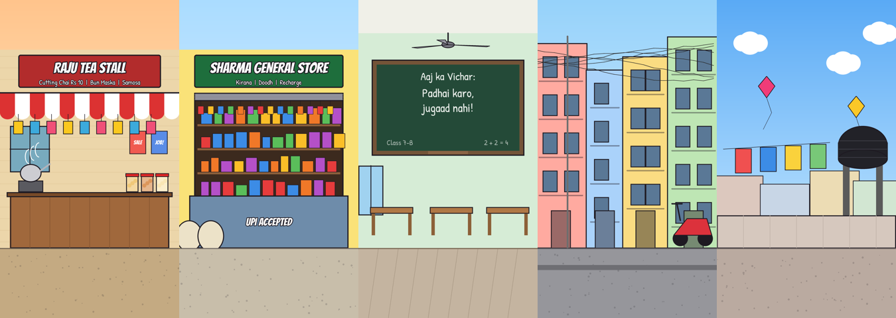

# The example channel: Tapri Gang

This project was built for **Tapri Gang**, a Hindi desi stickman comedy. Everything here lives in `data/` and `branding/`;
replace it with your own channel (see "Make your own channel" in the README).

| Field | Value |
|---|---|
| Name | Tapri Gang |
| Handle | @taprigangcomedy (YouTube and Instagram) |
| Tagline | Ek cutting chai, teen dost, full masti |
| Category | Comedy |
| Language | Hindi voices, Hinglish titles and captions |
| Logo / banner | `branding/logo.png` (800x800), `branding/banner.png` (2560x1440, text inside the safe area) |
| Upload times | 7:00–7:30 AM, 12:00–12:30 PM, 7:00–7:30 PM IST (a random minute inside each window) |
| Playlists | Tapri Pe Charcha, School Ke Kisse, Kirana Comedy, Gali Ke Kaand, Chhat Pe Scene (made automatically) |

## The cast (`data/cast.json`)

| | Pappu | Golu | Chhotu |
|---|---|---|---|
| Who | over-confident jugaadu | gentle round foodie | sharp kid who runs the chai tapri |
| Look | tall, saffron gamcha, spiky hair, moustache | round belly, green topi, rosy cheeks | small, blue towel and headband |
| Catchphrase | "Bhai, jugaad hai na!" | "Pehle samosa, phir baat." | "Do cutting, aur ek dimaag." |
| ElevenLabs voice | Bunty – Funny Best Friend | Bittu – Heavy Kid Cartoon | Omar J – Very Young Storyteller |

## Why this niche (vidIQ research, October 2026)
Hindi animated desi comedy is one of the fastest growing faceless niches in India. A comparable channel that started in April 2025 reached
269K subscribers with about 2M average views per video. "desi comedy video" searches grew about 230% in a month, "cartoon video" gets about
770K searches a month with low competition. Few channels run recurring *characters* in short, clean, India-specific situations; that is the moat.
Keyword research and the SEO formula: [SEO_RESEARCH.md](SEO_RESEARCH.md).

## Locations
`toon/sets.py` draws them: Raju's chai tapri, Sharma General Store (kirana), a school classroom, a gali with tangled wires, a rooftop with a
water tank and kites.

